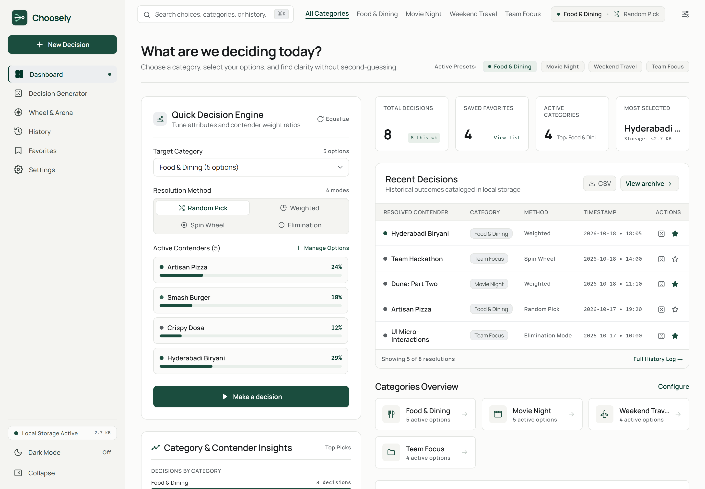
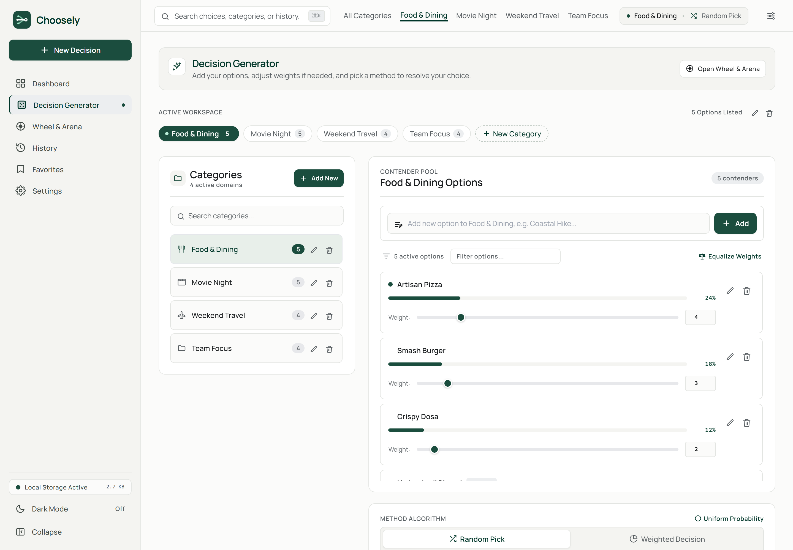
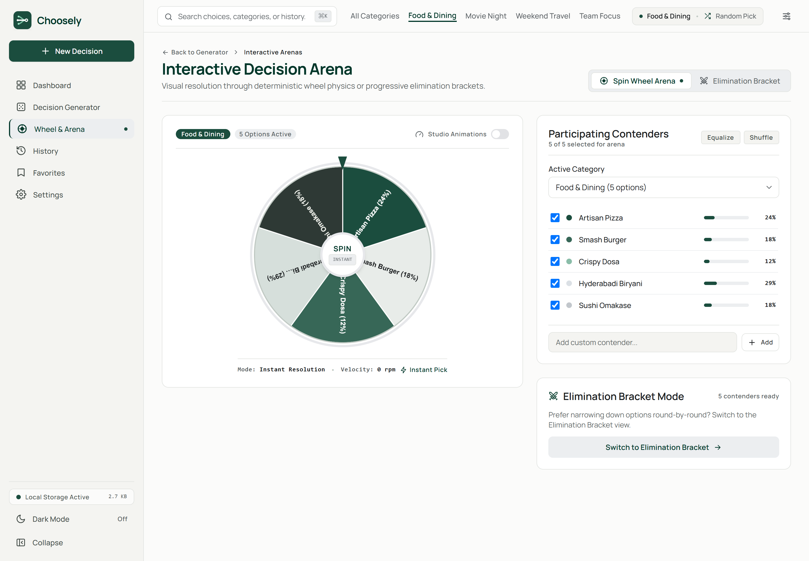
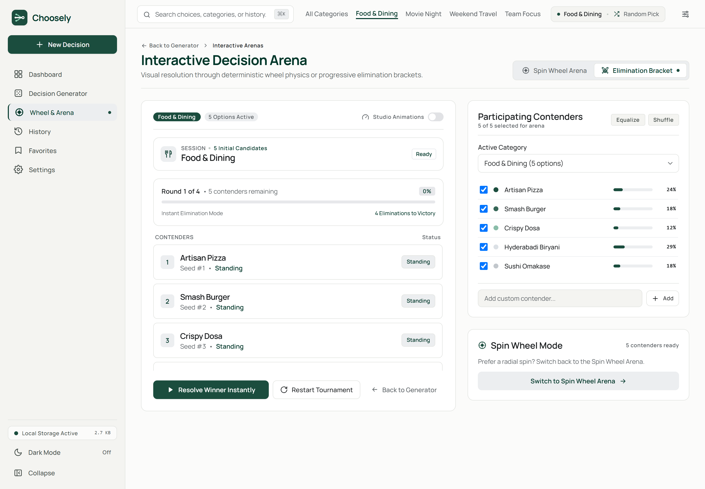
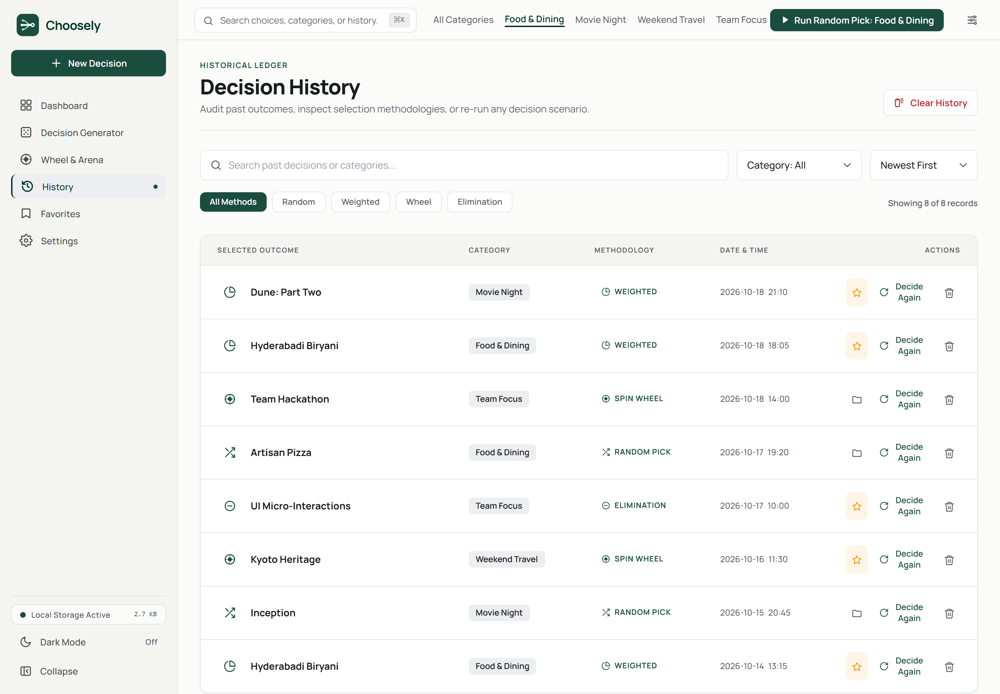
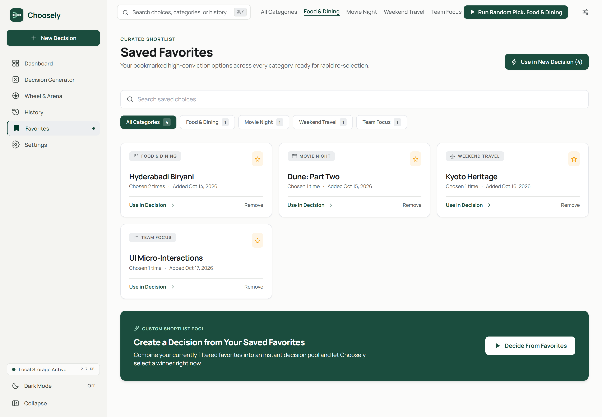
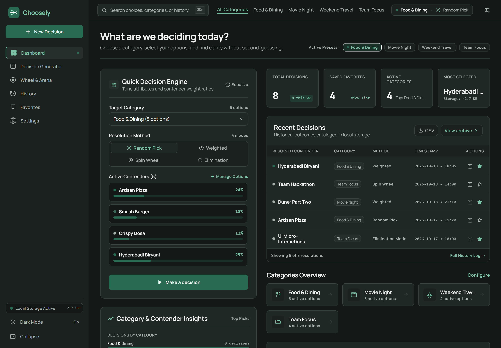
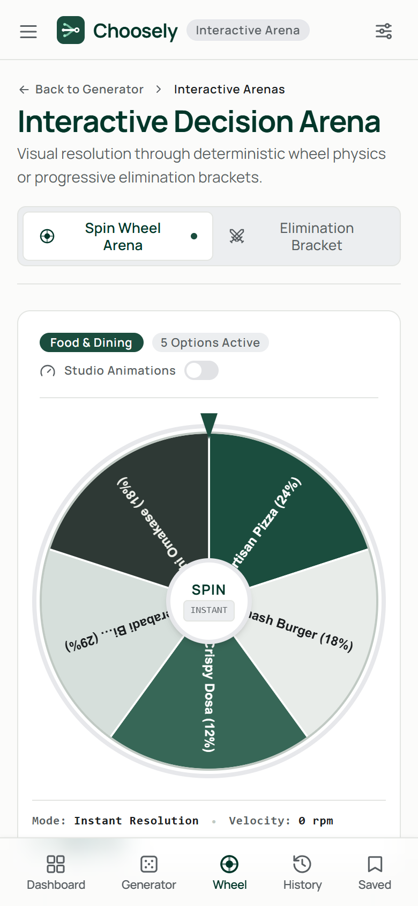

# Choosely

A modern, high-precision decision-making application built with **React 18**, **Vite**, and **Tailwind CSS**. Choosely transforms decision paralysis into swift, transparent outcomes by combining weighted decision modeling, interactive canvas wheel physics, progressive elimination brackets, and local data persistence.

100% client-side architecture with zero tracking, zero external backends, and full offline capability.

---

## Visual Tour

### Primary Decision Workspaces

| **Interactive Dashboard** | **Decision Generator** |
|:---:|:---:|
|  |  |
| *Unified command center with Quick Decision Engine, category selector, recent outcomes ledger, and real-time category analytics.* | *Contender pool editor with custom category management, relative weight sliders (1–100), probability bars, and keyboard shortcuts.* |

### Interactive Decision Arenas

| **High-DPI Spin Wheel Arena** | **Elimination Bracket Tournament** |
|:---:|:---:|
|  |  |
| *Deterministic HTML5 Canvas spin wheel with cubic ease-out deceleration, live RPM speedometer, and participant checklists.* | *Progressive round-by-round elimination tournament with contender seeding, auto-run progression, and manual round stepping.* |

### Audit Ledger & Curated Favorites

| **Searchable Decision History** | **Saved Favorites Shortlist** |
|:---:|:---:|
|  |  |
| *Comprehensive audit log with method filters, category filtering, chronological sorting, CSV export, and instant 'Decide Again' reloading.* | *Curated bookmark collection with historical selection frequency, quick-start decision pools, and direct workspace integration.* |

### Themes & Mobile Experience

| **Dark Mode Theme** | **Mobile Responsive Experience** |
|:---:|:---:|
|  |  |
| *High-contrast charcoal & soft sage dark palette with zero-flicker pre-paint initialization and instant toggle.* | *Adaptive mobile layout featuring bottom touch navigation, collapsible drawer menus, and responsive touch controls.* |

---

## Core Capabilities

- **4 Decision Resolution Modes**:
  - **Random Pick**: Pure uniform probability across active category candidates.
  - **Weighted Decision**: Stochastic selection weighted by user-assigned priority scores (`1–100`).
  - **Spin Wheel Arena**: High-performance HTML5 Canvas wheel that calculates exact target angles to match the selected winner, supporting animated spins or instant picks.
  - **Elimination Mode**: Progressive tournament bracket narrowing contenders down round-by-round until one champion stands.
- **Client-Side Data Architecture**:
  - All workspace state persists to `window.localStorage` under key `decision_generator_state`.
  - Zero server calls, telemetry, or third-party cookies; total user privacy.
  - Resilient state sanitization (`normalizeAppState`) automatically validates schema consistency on launch.
- **Backup & Portability (Schema v1)**:
  - Export full snapshots to human-readable JSON files (`choosely-backup-YYYY-MM-DD.json`).
  - Import snapshots with **Merge Data** (additive) or **Replace Workspace** (clean restore).
- **Theme & Motion Controls**:
  - Independent **Light Mode** and **Dark Mode** states with custom CSS variables.
  - **Studio Animations** toggle: switch between smooth cinematic easing or instantaneous zero-latency picks.
  - Respects OS `prefers-reduced-motion` settings automatically.

---

## Decision Engine & Mathematics

The decision algorithms in [`src/utils/decisionAlgorithms.js`](file:///src/utils/decisionAlgorithms.js) are decoupled from the React rendering layer for deterministic, testable behavior across both standalone view modes and modal workflows.

### 1. Weighted Stochastic Selection
Contender weights $w_i \in [1, 100]$ are normalized to establish a probability distribution:

$$P(O_i) = \frac{w_i}{\sum_{j=1}^{N} w_j}$$

A pseudo-random float $r \in [0, 1)$ is sampled against the cumulative distribution function:

```javascript
export function selectWeightedOption(options) {
  const totalWeight = options.reduce((sum, opt) => sum + (Number(opt.weight) || 1), 0);
  let threshold = Math.random() * totalWeight;
  for (const option of options) {
    threshold -= (Number(option.weight) || 1);
    if (threshold <= 0) return option;
  }
  return options[options.length - 1];
}
```

### 2. Deterministic Spin Wheel Physics
To guarantee visual fidelity without outcome desynchronization, the winning option is resolved *first* according to the chosen algorithm (uniform or weighted). Next, [`calculateWheelRotationForWinner`](file:///src/utils/decisionAlgorithms.js) computes the precise angular offset needed to align the winning segment with the top pointer:

$$\theta_{\text{target}} = \theta_{\text{current}} + 2\pi k + \left(\frac{3\pi}{2} - \theta_{\text{winnerMid}}\right) + \delta$$

where $k \in [5, 8]$ represents full rotations, and $\delta$ provides natural micro-jitter within the slice boundaries. The wheel decelerates using a cubic ease-out curve:

$$f(t) = 1 - (1 - t)^3$$

### 3. Progressive Elimination Bracket
[`buildEliminationOrder`](file:///src/utils/decisionAlgorithms.js) creates an elimination sequence using a Fisher-Yates shuffle. In each tournament round, contenders are paired into head-to-head match-ups, recording knockout steps until a final victor emerges.

---

## Tech Stack

- **Framework**: [React 18](https://react.dev/) (`react`, `react-dom`)
- **Routing**: [React Router v6](https://reactrouter.com/) (`react-router-dom`)
- **Build Tool**: [Vite 5](https://vitejs.dev/) with Fast Refresh
- **Styling**: [Tailwind CSS 3](https://tailwindcss.com/) with semantic color tokens
- **Graphics**: HTML5 Canvas with device-pixel-ratio scaling for Retina displays
- **Quality & Automation**: Playwright Core for automated screenshot testing and Chromium driver

---

## Getting Started

### Prerequisites

- [Node.js](https://nodejs.org/) (v18.0.0 or later)
- `npm` (v9.0.0 or later)

### Installation & Development

```bash
# Clone the repository
git clone https://github.com/Madhan-mdn/choosely.git
cd choosely

# Install dependencies
npm install

# Start development server
npm run dev
```

Visit `http://localhost:5173` to explore the application locally.

### Production Build & Preview

```bash
# Compile and optimize for production
npm run build

# Preview the production build locally
npm run preview
```

### Reproducing Application Screenshots

Choosely includes a headless browser screenshot capture script that spins up an in-process Vite preview server, seeds sample categories, and captures high-resolution screenshots into `docs/screenshots/`:

```bash
# Ensure build exists first
npm run build

# Capture all 10 page views across desktop, mobile, and dark theme
npm run screenshots
```

---

## Project Structure

```text
├── docs/
│   └── screenshots/                 # Application screenshots referenced in documentation
│       ├── dashboard.png
│       ├── decision-generator.png
│       ├── spin-wheel.png
│       ├── elimination-mode.png
│       ├── history.png
│       ├── favorites.png
│       ├── settings.png
│       ├── dashboard-dark.png
│       ├── dashboard-mobile.png
│       └── spin-wheel-mobile.png
├── public/
│   └── favicon.svg                  # Choosely SVG brand favicon
├── scripts/
│   └── capture-screenshots.mjs      # In-process Vite preview & Playwright capture script
├── src/
│   ├── components/
│   │   ├── decisions/
│   │   │   ├── CategorySelector.jsx       # Category navigation pills & CRUD sidebar panel
│   │   │   ├── DecisionMethodSelector.jsx # 2x2 algorithm selector cards
│   │   │   ├── EliminationView.jsx        # Round-by-round elimination tournament arena
│   │   │   ├── OptionEditor.jsx           # Contender CRUD & weight adjustment sliders
│   │   │   ├── ResultModal.jsx            # Decision animation & outcome modal dialog
│   │   │   └── SpinWheel.jsx              # High-DPI HTML5 Canvas spin wheel
│   │   ├── layout/
│   │   │   ├── AppLayout.jsx              # Responsive app shell (Header, Sidebar, Main)
│   │   │   ├── MobileNavigation.jsx       # Mobile drawer & docked bottom navigation
│   │   │   ├── PageHeader.jsx             # Search bar (Ctrl+K), category pills & quick actions
│   │   │   └── Sidebar.jsx                # Collapsible desktop navigation & status indicators
│   │   └── ui/
│   │       ├── Button.jsx                 # Accessible button variants with loading states
│   │       ├── ChooselyLogo.jsx           # Vector brand logo component
│   │       ├── EmptyState.jsx             # Clean fallback display for empty datasets
│   │       ├── Icon.jsx                   # Zero-dependency inline SVG icon library
│   │       ├── Modal.jsx                  # Accessible dialog with focus trap & escape key handler
│   │       ├── Select.jsx                 # Styled dropdown select element
│   │       └── Toast.jsx                  # Floating feedback notification system
│   ├── context/
│   │   └── AppStateContext.jsx      # Central state provider, CRUD actions & execution guards
│   ├── hooks/
│   │   └── useTheme.js              # Instant Light/Dark class synchronization
│   ├── pages/
│   │   ├── Dashboard.jsx            # Quick Decision Engine, workspace metrics & recent history
│   │   ├── Favorites.jsx            # Curated shortlist with direct decision execution
│   │   ├── Generator.jsx            # Primary category & contender management studio
│   │   ├── History.jsx              # Searchable, filterable audit ledger with CSV export
│   │   ├── Settings.jsx             # Theme, motion, JSON backup/restore & data reset
│   │   └── WheelArena.jsx           # Spin Wheel & Elimination Bracket views
│   ├── utils/
│   │   ├── decisionAlgorithms.js    # Pure selection math, canvas physics & brackets
│   │   ├── exportImport.js          # Schema v1 JSON validation, non-destructive merge & export
│   │   └── storage.js               # LocalStorage sanitization, normalization & persistence
│   ├── App.jsx                      # Route definitions & layout wrappers
│   ├── index.css                    # Semantic design tokens & utility classes
│   └── main.jsx                     # Application bootstrap & DOM mount
├── index.html                       # Document shell with anti-flash theme script
├── package.json                     # Dependency manifests & npm scripts
├── postcss.config.js                # PostCSS configuration
├── tailwind.config.js               # Tailwind design tokens, typography & spacing
└── vite.config.js                   # Vite configuration
```

---

## Keyboard Shortcuts

| Shortcut | Context | Action |
|---|---|---|
| `Ctrl + K` / `Cmd + K` | Global | Focus global search input |
| `Ctrl + Enter` / `Cmd + Enter` | Decision Generator | Execute decision for active category |
| `Escape` | Modals / Dialogs | Dismiss active modal or overlay |

---

## License

This project is licensed under the [MIT License](LICENSE).
